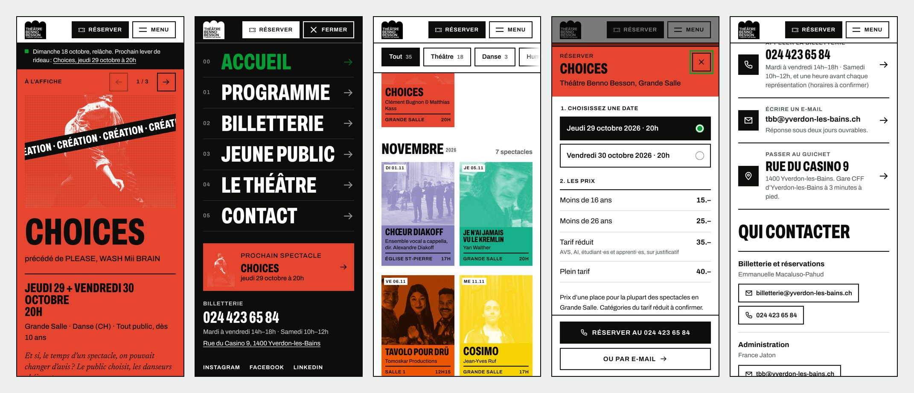
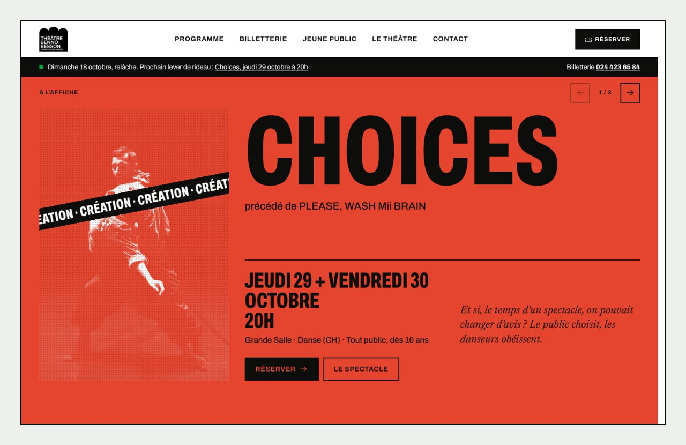

# Théâtre Benno Besson — site et Studio

Refonte de [theatrebennobesson.ch](https://www.theatrebennobesson.ch/) : un site rapide pensé d’abord pour le téléphone, et un Studio Sanity en français où l’équipe gère seule tout le programme et toutes les pages.

> **Le fil rouge : « Le plaisir à l’affiche, pour toutes et tous. »** Chaque spectacle a son affiche, au format suisse, dans sa propre encre.





## Le dépôt

```
web/        le site (Next.js 16, React 19), lit les contenus dans Sanity
studio/     le Studio Sanity v6 : schémas, tableau de bord, aperçu en direct
maquette/   la maquette statique d’origine et sa planche concept (voir maquette/README.md)
docs/       aperçus pour ce README
```

Les deux applications partagent les dépendances installées à la racine (espaces de travail npm).

```bash
npm install
npm run dev            # le site sur http://localhost:3000
npm run dev:studio     # le Studio sur http://localhost:3333
```

Tant que Sanity est vide, le site affiche le jeu d’amorçage local (`web/sanity/amorce.json` : tout le site actuel, 386 spectacles de 2020–21 à 2026–27, 17 pages). Il bascule tout seul sur Sanity dès le premier spectacle publié.

## Le Studio, pour l’équipe du théâtre

Adresse : **https://theatrebennobesson.sanity.studio** · mode d’emploi complet : **[STUDIO.md](STUDIO.md)**.

| Rubrique | Ce qu’on y fait |
| --- | --- |
| **Tableau de bord** | Les prochaines dates avec leurs boutons de statut (Complet en un clic), les tâches classées par urgence (conflits de salle, heures à confirmer, fiches incomplètes, liens de réservation manquants…), les brouillons, les messages, « Nouveau » avec des modèles (Midi théâtre, Jeune public, Saison musicale). |
| **Agenda** | Toutes les représentations en liste ou en mois : statuts, ajout, modification, glisser-déposer d’une date, conflits de salle signalés, « Annuler » pour défaire. |
| **Communication** | Lettre d’information prête à coller dans Brevo, feuille de salle et agenda imprimables, textes et visuels pour les réseaux, exports pour la brochure. |
| **Programme** | Les spectacles rangés tout prêts : à venir, complets, jeune public, Midi théâtre, passés. Un spectacle = titre, artistes, genre, visuel, accroche, dates. Le reste est facultatif. |
| **Accueil** | Les spectacles mis à l’affiche (vide = les trois prochains automatiquement) et les sections de la page. |
| **Pages** | Billetterie, Le théâtre, Contact, Jeune public… Chaque page est une pile de sections à ajouter, déplacer ou supprimer : texte, blocs d’infos, tarifs, citation, frise, galerie, équipe, formules, accès, appel à l’action, mur d’affiches, agenda, questions fréquentes, contact, lettre d’information. |
| **Lieux, Tarifs, Équipe, Partenaires** | Saisis une fois, réutilisés partout. Une grille de prix modifiée change tous les spectacles qui l’utilisent. |
| **Messages reçus** | Les messages du formulaire de contact et les inscriptions à la lettre, à marquer « traité ». |
| **Réglages du site** | Coordonnées, horaires du guichet, accès, menu, pied de page, réseaux sociaux, bandeau d’annonce urgent. |
| **Aperçu du site** | Le site à côté du formulaire : chaque modification s’y voit avant publication, un clic sur un texte ouvre le bon champ. |

Les gestes courants :

- **Une date est complète** : dans le spectacle, onglet « Dates et billets », passer la date sur « Complet ». Le bandeau rouge apparaît sur l’affiche, le bouton Réserver disparaît.
- **Ajouter un spectacle** : « Nouveau spectacle ». Saison, salle et prix sont préremplis. L’encre de l’affiche est prise dans le visuel si on la laisse vide.
- **Prévenir d’une fermeture** : Réglages du site, onglet « Annonce », cocher « Afficher le bandeau ».
- **Lien direct vers une section** : chaque section a un encart « Lien direct ». L’ancre « tarifs » donne `/billetterie#tarifs`. Le programme accepte `/programme#danse`, `#jeune-public`, `#midi-theatre`, `#places`.

Une modification publiée est en ligne en quelques secondes, sans redéploiement.

## Le site

- **Téléphone d’abord.** Chaque composant est écrit pour 390 px puis élargi (640, 1024, 1280). Cibles tactiles de 44 px, pas de survol collant, zones sûres de l’iPhone respectées.
- **La navigation.** Sur téléphone, un menu plein écran : le rideau noir tombe, le spectacle suivant y est mis en avant, la billetterie s’appelle d’un geste. C’est un `<dialog>` natif : le focus y reste, Échap le ferme, la page derrière ne défile plus. Il se ferme au clic sur un lien (même vers la page en cours), au changement de page et au passage en format ordinateur. En descendant, l’en-tête s’efface pour laisser la place au contenu ; il revient au moindre geste vers le haut. La barre de filtres du programme le suit. Sur ordinateur, les liens sont soulignés au survol, la rubrique en cours est marquée.
- **Réserver.** Un tiroir (feuille du bas sur téléphone) : choix de la date, prix, puis la billetterie en ligne ou le téléphone. Sur la fiche d’un spectacle, une barre « Réserver » reste à portée de pouce.
- **Contact.** Appeler, écrire ou venir en un geste, l’annuaire des services, un formulaire qui garde les saisies en cas d’erreur et envoie les messages dans le Studio.
- **Rapide.** Toutes les pages sont générées à l’avance. Les images sont servies en AVIF/WebP à la bonne taille par le CDN de Sanity. Les polices sont hébergées avec le site et allégées (Newsreader en une seule graisse). Mesure sur téléphone simulé (processeur ralenti ×4, 4G) : LCP entre 0,9 et 1,4 s, décalage de mise en page quasi nul, 135 ko de polices et environ 150 ko de JavaScript compressé.

### Variables d’environnement

Toutes facultatives en local. À déclarer chez l’hébergeur du site (Vercel par exemple), jamais dans le code.

| Variable | Rôle |
| --- | --- |
| `NEXT_PUBLIC_SITE_URL` | Adresse publique du site, pour le plan du site et les liens de partage. |
| `SANITY_API_READ_TOKEN` | Jeton « Viewer » : aperçu des brouillons dans le Studio. |
| `SANITY_API_WRITE_TOKEN` | Jeton « Editor » : enregistre les messages du formulaire dans le Studio. Sans lui, en production, le formulaire renvoie vers l’e-mail du théâtre. |
| `NEXT_PUBLIC_SANITY_PROJECT_ID`, `NEXT_PUBLIC_SANITY_DATASET` | Par défaut `pgmabzq0` et `production`. |
| `NEXT_PUBLIC_SANITY_STUDIO_URL` | Par défaut `https://theatrebennobesson.sanity.studio`. |
| `TBB_SOURCE` | `auto` (défaut), `sanity` ou `amorce`. |
| `TBB_AUJOURDHUI` | Fige la date du jour pour une démonstration, par exemple `2026-10-18T12:00:00+02:00`. |

Côté Studio : `SANITY_STUDIO_PREVIEW_URL`, l’adresse du site affichée dans « Aperçu du site » (par défaut `http://localhost:3000`).

## GitHub Pages (en place)

Le site est publié sur **https://wearebrothers-ch.github.io/Theatre-/** par le workflow `.github/workflows/site.yml` :

- à chaque envoi sur la branche : migration des contenus dans Sanity (`studio/scripts/migrer.mjs` : crée ce qui manque, met à jour ce que l’équipe n’a jamais retouché, n’écrase jamais un document modifié dans le Studio), publication du Studio, construction et publication du site ;
- toutes les 15 minutes : le site est reconstruit seulement si un contenu a été publié dans le Studio (ou si le jour a changé, pour l’agenda). Une modification publiée est donc en ligne en 15 minutes au plus ;
- le jeton Sanity est lu dans les secrets du dépôt (`SANITY_AUTH_TOKEN`).

Version statique, sans serveur : les formulaires ouvrent la messagerie de la personne avec le message prêt (au lieu de l’enregistrer dans le Studio), et l’aperçu des brouillons dans le Studio n’est pas disponible. Pour l’enregistrement des messages et la mise à jour en quelques secondes, héberger `web` sur Vercel (voir plus bas).

Réglage unique côté GitHub : Settings → Pages → Build and deployment → Source : **GitHub Actions**.

## Mise en ligne

Il faut le jeton `SANITY_AUTH_TOKEN` dans l’environnement (réglages de l’environnement Claude Code, ou `npx sanity login` en local).

1. **Migrer les contenus** dans le dataset `production`, images et PDF compris, sans rien écraser (le workflow GitHub le fait à chaque envoi) :
   ```bash
   npm run migrer                                # ou, sans rien écrire :
   npm run migrer:essai --workspace studio
   ```
2. **Publier le Studio** sur https://theatrebennobesson.sanity.studio :
   ```bash
   npm run deploy:studio
   ```
3. **Autoriser le site** à lire Sanity depuis le navigateur (mise à jour en direct) :
   ```bash
   cd studio
   npx sanity cors add http://localhost:3000 --credentials
   npx sanity cors add https://www.theatrebennobesson.ch --credentials
   ```
4. **Créer les jetons du site** dans sanity.io/manage, projet « Théâtre Benno Besson », API, Tokens : un « Viewer » (`SANITY_API_READ_TOKEN`) et un « Editor » (`SANITY_API_WRITE_TOKEN`).
5. **Déployer le site** : sur Vercel, nouveau projet depuis ce dépôt, dossier racine `web`, puis les variables ci-dessus.
6. **Inviter l’équipe** : sanity.io/manage, Members, rôle « Editor » pour chaque personne.

## Contrôles

```bash
npm run typecheck --workspace web
npm run build --workspace web
cd studio && npx tsc --noEmit && npx sanity schema validate
```

## Reprise de l’ancien site

Le site Wix a été relevé le 18 octobre 2026 (collections CMS de chaque saison, pages, PDF, images). `studio/scripts/reprise-wix.mjs` transforme ces exports en `studio/donnees/reprise.json` (dates et heures lues dans les textes, prix, salles, générique, citations, revues de presse…), puis `studio/scripts/generer-amorce.mjs` en fait les documents Sanity, en gardant la mise en forme de la maquette pour la saison en cours. Les images et PDF encore chez Wix sont copiés dans Sanity par la migration.

## Contenus à valider avec le TBB

Repris du site actuel. À confirmer : les heures notées « à confirmer » (quelques festivals des saisons passées), le nombre de places de la Grande Salle (460 sur la page Histoire, 450 sur la fiche technique), les catégories du tarif réduit, le montant de la formule « Ami·e pour la vie », et l’adresse publique du site (Réglages du site) le jour où le domaine theatrebennobesson.ch sera branché.
